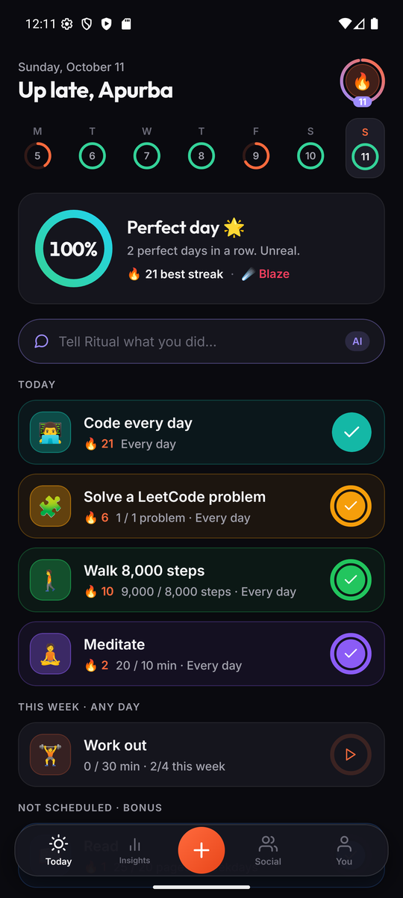
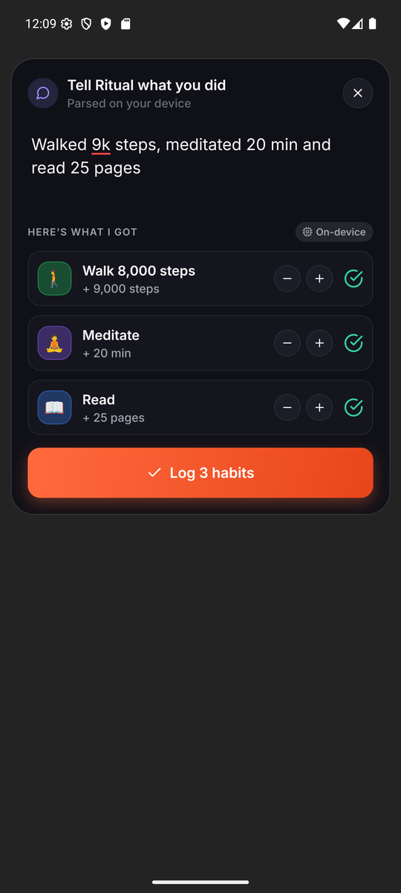
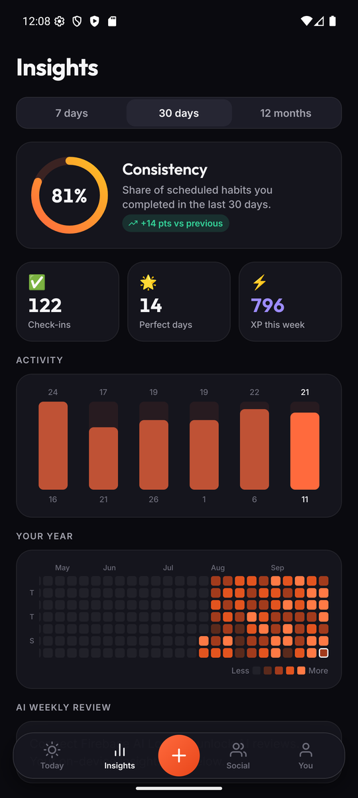
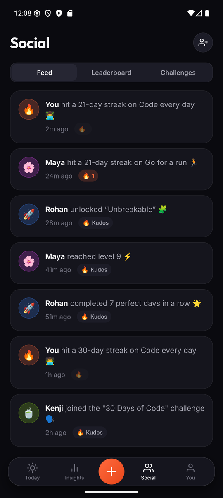
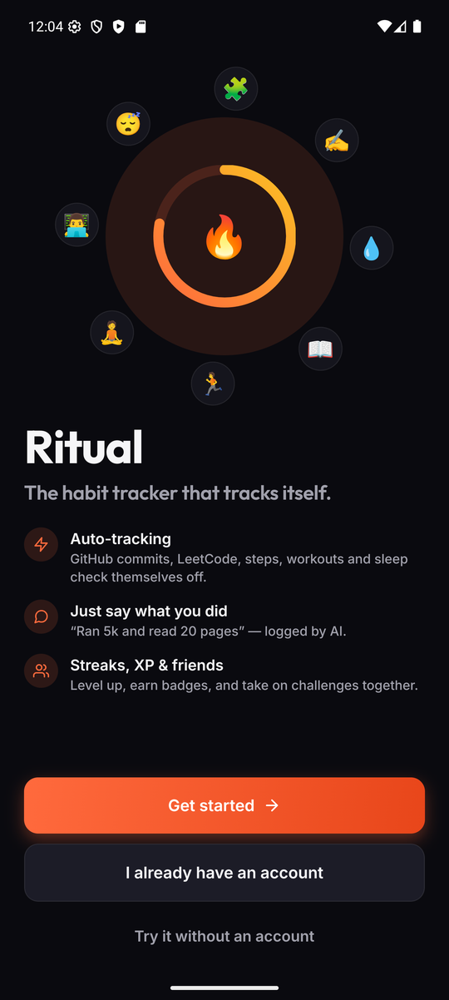
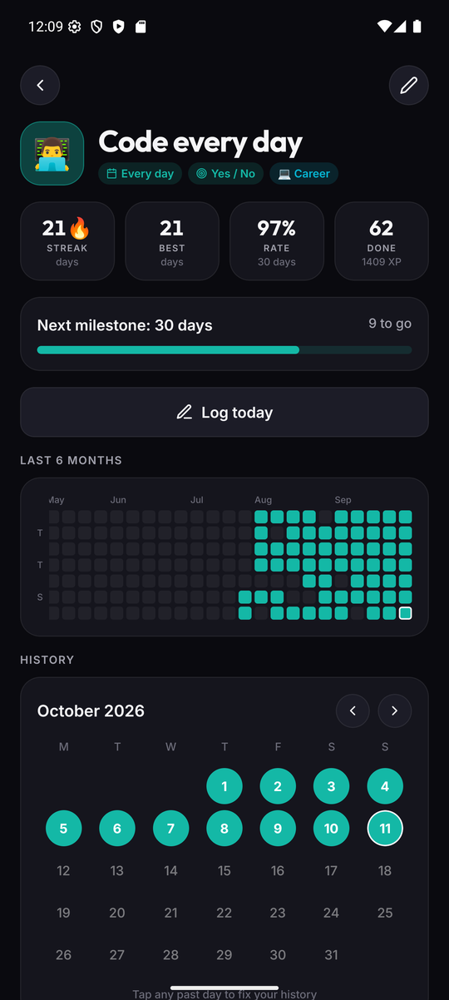
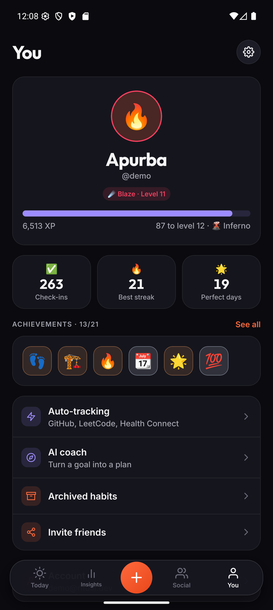
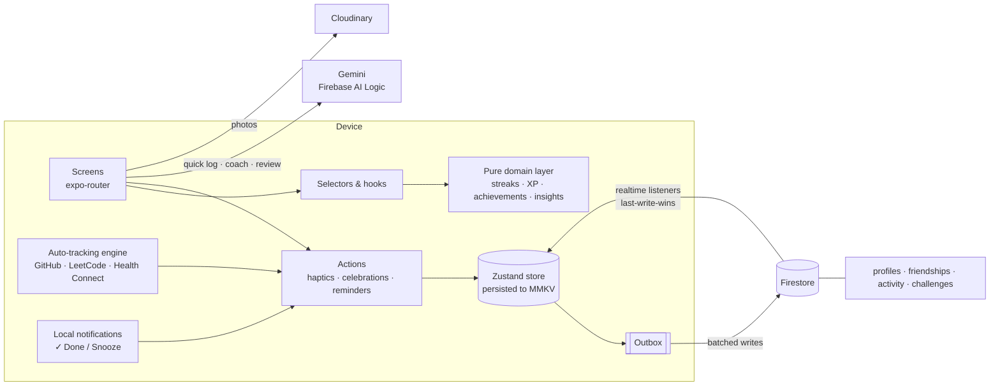

<p align="center">
  
</p>

<h1 align="center">Ritual</h1>
<p align="center"><b>The habit tracker that tracks itself.</b></p>

<p align="center">
  Auto-tracking from GitHub, LeetCode &amp; Health Connect · log by just saying what you did · streaks, XP &amp; friends.<br/>
  React Native (Expo SDK 57) · TypeScript · Firebase · Gemini
</p>

<p align="center">
  <a href="https://ritual-37ccf.web.app"><b>🌐 Live demo → ritual-37ccf.web.app</b></a>
</p>

<p align="center">
  <a href="https://github.com/Apurba2509/Ritual/actions/workflows/ci.yml"></a>
  
  
  
  
</p>

<p align="center">
  
  
  
  
</p>
<p align="center">
  
  
  
</p>

---

## Why Ritual?

Most habit trackers die the same death: you stop opening the app to tick boxes. Ritual removes the manual work.

| Problem | Ritual's answer |
| --- | --- |
| "I forgot to log it" | **Auto-tracking** — coding habits complete from your GitHub contributions or LeetCode submissions; steps, workouts and sleep come from Health Connect (Google Fit, Samsung Health, Fitbit, Strava…). History is back-filled, so streaks start where you already are. |
| "Logging is tedious" | **Say it, done** — "ran 5k, read 20 pages and meditated 15 min" becomes three check-ins (Gemini via Firebase AI Logic, with an offline on-device parser as fallback). |
| "Reminders are noise" | **Smart reminders** — only for habits not yet done, with a **✓ Done** button right in the notification; an evening nudge only when a streak is actually at risk. |
| "I lose motivation" | **Gamification that's honest** — XP and levels derived from your real history, streak milestones, 21 achievements, perfect-day runs, confetti. |
| "Doing it alone is hard" | **Social** — friends by username, a feed with 🔥 kudos, nudges, weekly leaderboards, group challenges. |
| "I don't know what to change" | **Insights + AI coach** — year heatmap, weekday patterns, mood correlations, an AI weekly review, and a coach that turns a goal into a habit plan. |

## Feature tour

- **Today** — week strip with per-day rings, daily progress, one-tap check / +1 / focus timer per habit, long-press for notes, mood, photo proof or a rest day (protects your streak).
- **Habits** — yes/no, count (glasses, pages, steps) or duration; daily, specific weekdays or *N× per week*; reminders; difficulty; intention ("why this matters").
- **Auto-tracking** — GitHub (contribution calendar), LeetCode (submission calendar), Health Connect (steps / exercise / sleep). Runs on launch, on resume and on pull-to-refresh.
- **Quick log** — natural-language logging with a review step before anything is saved.
- **Focus timer** — timestamp-based (survives backgrounding), keeps the screen awake, notifies when done, logs minutes automatically.
- **Insights** — consistency vs. previous period, activity bars, GitHub-style year heatmap, weekday strengths, per-habit consistency, mood links, AI weekly review.
- **Gamification** — XP = f(difficulty, streak) with milestone bonuses; triangular level curve with ranks (Spark → Eternal); 21 achievements across 4 tiers; shareable celebration cards.
- **Social** — friend requests, live activity feed with kudos, nudges, friends & global weekly leaderboards, public/invite-only challenges with live member leaderboards.
- **Accounts** — email/password, guest mode with one-tap upgrade (guest history migrates to the cloud), password reset, data export, account deletion.
- **Polish** — dark & light themes, haptics, spring animations, confetti, Android notification actions, offline-first everything.

## Architecture



**Key engineering decisions**

- **Local-first.** Every interaction writes to MMKV synchronously — the UI never waits on the network and works fully offline (and fully without an account). An **outbox** records changed documents; the sync engine drains it to Firestore in batches with exponential back-off, and realtime listeners stream other devices' changes back. Conflicts resolve **last-write-wins** on a monotonic client clock; writes are idempotent (`entryId = habitId_yyyy-MM-dd`), so a crash mid-sync just resends the same batch.
- **Derived, not stored, gamification.** Streaks, XP, levels and achievements are pure functions of habit history (`src/domain`). Two devices can never disagree about your level, back-filled integration data instantly earns the right XP, and the logic is unit-tested.
- **Calendar days, not timestamps.** Entries are keyed by local `yyyy-MM-dd`, which makes DST, timezones and "did I do it today?" trivial and deterministic.
- **Secure by default.** Firestore security rules validate every collection (`firestore.rules`): private data is owner-only, usernames are claimed transactionally, friendship transitions are enforced, other users can only toggle *their own* kudos, challenge counters move by ±1. The Gemini key never ships in the app (Firebase AI Logic proxies it); Cloudinary uses an unsigned, restricted preset.
- **Smart notifications.** Reminders are scheduled as one-off notifications for the next few days and rebuilt whenever data changes — so a reminder for a habit you already finished simply doesn't exist.

## Tech stack

| Layer | Tech |
| --- | --- |
| App | Expo SDK 57 · React Native 0.86 (New Architecture) · React 19.2 · TypeScript (strict) |
| Navigation | expo-router 57 (typed routes, protected routes) |
| State & storage | Zustand 5 · react-native-mmkv 4 (Nitro) |
| Animation | Reanimated 4 · Gesture Handler · react-native-svg |
| Backend | Firebase Auth · Cloud Firestore (rules + indexes in repo) · Firebase Hosting (web) |
| AI | Gemini 3.5 Flash-Lite (quick log, ~1.5 s) & Gemini 3.5 Flash (coach, reviews) via Firebase AI Logic — schema-constrained JSON, low thinking budget, offline fallback parser |
| Integrations | GitHub contributions · LeetCode GraphQL · Android Health Connect |
| Media | Cloudinary (unsigned uploads, on-the-fly thumbnails) |
| Device | expo-notifications (actions) · expo-haptics · expo-image-picker · expo-keep-awake |
| Quality | Vitest (domain + sync unit tests) · `@firebase/rules-unit-testing` against the emulator · strict `tsc` · Prettier · GitHub Actions CI |

## Project structure

```
src/
  app/                 # screens (expo-router): (auth), (tabs), habit/, focus/, challenge/, …
  domain/              # pure TS: dates, schedules, streaks, XP, achievements, insights, NL parser (+ tests)
  data/                # store (Zustand+MMKV), sync engine, session, auth, hooks
  features/
    ai/                # Gemini: quick log, coach, weekly review
    habits/            # habit rows, log sheet, pickers, logging actions
    integrations/      # GitHub, LeetCode, Health Connect, auto-tracking engine
    notifications/     # smart scheduler, notification actions
    social/            # friends, feed, leaderboards, challenges (Firestore)
    gamification/      # celebrations
  ui/                  # design system: theme, Text, Button, Card, Sheet, charts, rings, confetti…
  lib/                 # firebase, storage, haptics, cloudinary, ids
firestore.rules        # security rules
firestore.indexes.json # composite indexes
tests/rules/           # security-rules test suite (emulator)
scripts/               # emulator seed data
```

## Getting started

**Requirements:** Node 20+, JDK 17, Android Studio (SDK + an emulator or a phone with USB debugging).

```bash
npm install
cp .env.example .env        # fill in Firebase (and optionally Cloudinary) values
npm run check               # type-check + unit tests
npx expo run:android        # builds the dev client and launches it
```

After the first native build you only need `npm start` and the installed dev client. The app runs without any `.env` values too — accounts/social/AI simply switch off and everything stays on the device.

> **Windows tip:** if the native build fails because of a space in the project path, run Gradle from PowerShell or map the folder to a drive letter (`subst R: "C:\path with spaces\Ritual"`).

### Firebase (free Spark plan)

1. [console.firebase.google.com](https://console.firebase.google.com) → **Create project** (Analytics optional).
2. **Add app → Web**, copy the config into `.env` (`EXPO_PUBLIC_FIREBASE_*`).
3. **Authentication → Sign-in method → Email/Password → Enable.**
4. **Firestore Database → Create database** (production mode, nearest region).
5. Deploy rules & indexes:
   ```bash
   npm i -g firebase-tools
   firebase login
   firebase use --add          # pick your project
   npm run deploy:rules
   ```
6. **AI Services → AI Logic → Get started → Gemini Developer API.** (If App Check is enforced for AI Logic, set it to *Unenforced* for development or register an App Check provider.)

### Cloudinary (photo check-ins & avatars)

1. Sign up at [cloudinary.com](https://cloudinary.com) (free tier). Your **cloud name** is on the dashboard.
2. **Settings → Upload → Upload presets → Add upload preset**
   - Signing mode: **Unsigned**
   - Folder: `ritual`
   - Allowed formats: `jpg, png, webp, heic` · Max file size: e.g. `5 MB`
   - Incoming transformation (optional): `c_limit,w_1600,q_auto`
3. Put `EXPO_PUBLIC_CLOUDINARY_CLOUD_NAME` and `EXPO_PUBLIC_CLOUDINARY_UPLOAD_PRESET` in `.env` and restart Metro.

### Web demo (Firebase Hosting)

```bash
npm run deploy:web          # expo export -p web && firebase deploy --only hosting
```

(LeetCode and Health Connect are mobile-only; GitHub uses the public events API on web.)

### Shareable Android build

```bash
npm i -g eas-cli && eas login
npm run build:apk           # EAS "preview" profile → installable APK link
```

## Testing

| Suite | What it covers | Command |
| --- | --- | --- |
| Domain unit tests | Dates/DST, daily & weekly streaks, rest days, back-filled history, completion rates, XP & level curve, deterministic snapshots, NL quick-log parser | `npm test` |
| Sync engine | Outbox queuing, tombstones, last-write-wins merges, ack versioning, guest → account migration | `npm test` |
| Security rules | 20 attack scenarios against the Firestore emulator — cross-user reads/writes, username theft, self-accepted friendships, forged kudos, counter inflation | `npm run test:rules` |
| Types | Strict TypeScript across app, scripts and tests | `npm run typecheck` |

All suites run in GitHub Actions on every push.

### Local Firebase (no cloud project needed)

```bash
npm run emulators            # Auth + Firestore emulators (needs Java 21)
npm run seed                 # 4 demo users, ~10 weeks of history, friends, feed, a group challenge
cp .env.emulator.example .env.local
npm start                    # sign in as demo@ritual.dev (password in scripts/emulator-config.ts)
```

On Android also forward the ports: `adb reverse tcp:9099 tcp:9099` and `adb reverse tcp:8085 tcp:8085`.

## Roadmap

- iOS HealthKit provider and Apple Watch complications
- Home-screen widgets (check off from the launcher)
- Push notifications for nudges via Cloud Functions + FCM
- Screen-time habits via Android UsageStats
- End-to-end tests with Maestro

---

Built by **Apurba Das** · MIT License
