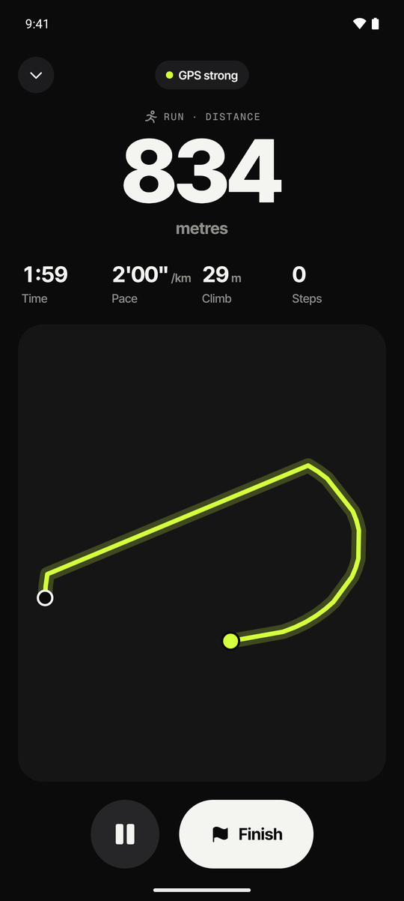
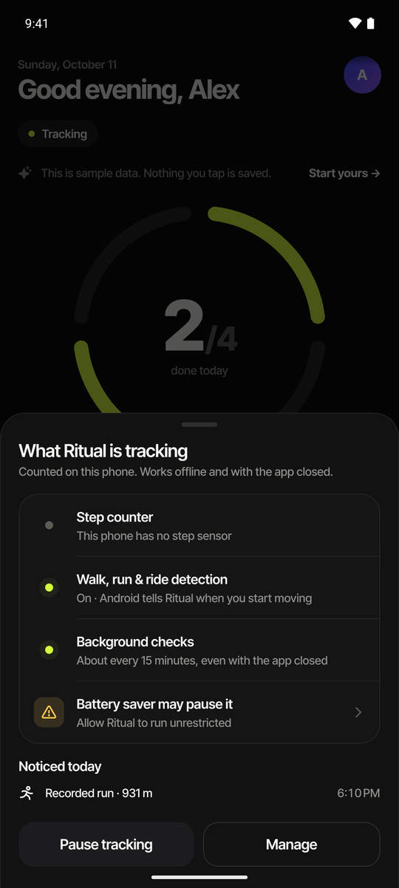
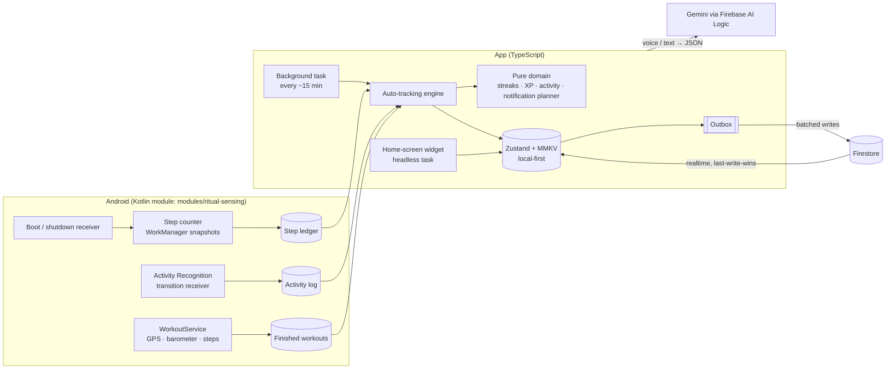

<p align="center">
  
</p>

<p align="center"><b>Habits that track themselves, and a coach that meets you where you are.</b></p>

<p align="center">
  Your phone counts the steps, notices the run, measures the scrolling, sees the commit, hears what you did, and checks the habit off.<br/>
  Offline, in the background, without you opening the app. When a goal is too big, it shrinks it; when it gets easy, it grows it.
</p>

<p align="center">
  <a href="https://ritual-37ccf.web.app"><b>Live demo → ritual-37ccf.web.app</b></a>
</p>

<p align="center">
  <a href="https://github.com/Apurba2509/Ritual/actions/workflows/ci.yml"></a>
  
  
  
  
  
</p>

<p align="center">
  
  
  
  
</p>
<p align="center">
  
  
  
  
</p>

---

## Why it's different

Every habit tracker has streaks. They all die the same way: you stop opening the app to tick boxes.
Ritual is built around one idea: **the best check-in is the one you never have to make.**

| Most habit apps | Ritual |
| --- | --- |
| You tap "done" | Your **phone's own sensors** do it: a hardware step counter read by a background worker, Android activity recognition for walks / runs / rides, and a GPS + barometer workout recorder. It works **with the app closed, with no internet, and even with no GPS** (distance falls back to steps × stride). |
| Steps need a second fitness app | Steps are counted **on the device by Ritual itself**; Health Connect is optional. |
| Coding habits are honour-system | **GitHub** contributions and **LeetCode** submissions complete coding habits, with a year of history back-filled. |
| Logging is typing into forms | **Say it**: "ran 5k and read 20 pages" → two check-ins (speech recognition → Gemini, with an on-device parser as fallback). |
| Reminders nag about things you already did | A **notification planner** rebuilds the schedule whenever data changes. Walk and the step reminder disappears; a "last call" only fires when a real streak is about to break. |
| You have to open the app | A **home-screen widget** shows the day ring and completes habits with one tap; on **Android 16** a live workout becomes a status-bar **Live Update**. |
| Miss a day, lose the streak, quit | An on-device **behaviour engine** tracks *habit strength* (a miss barely dents it), applies **never miss twice** with a two-minute version, and offers **easy mode** after a lapse instead of guilt. |
| Goals are fixed and often too big | **Adaptive goals**: a target that keeps getting missed is shrunk to what you actually do; one that's become easy grows a step toward your real goal. Every day keeps the goal it was held to, so history never changes. |
| "You've used Instagram for 2 hours" pop-ups | **Screen time** from Android's own usage log (offline, app closed, no polling) and a **mindful pause** before the apps you choose: a breath that grows with each open, catch-up windows for FOMO, and your two-minute habit offered as the swap. |

## Feature tour

- **Today**: the *day ring*, one segment per habit that lights up as you go; a week strip; swipe a habit right to complete it; finished habits fold into a compact "Done" list; a live "Tracking" indicator that always tells you what the phone is sensing; one calm **coach card** with the single most useful suggestion right now.
- **Behaviour engine (on-device, no AI needed)**:
  - **Habit strength**: an exponential moving average of showing up (in the spirit of Loop Habit Tracker), with phases from *building* to *automatic* and an honest "about N days to automatic".
  - **Patterns**: the time you actually do each habit (reminders move there), your weak weekday, trend, and when you're slipping.
  - **Never miss twice**: the day after a miss, the two-minute version counts in full and keeps the streak.
  - **Easy mode and fresh starts**: after a lapse or at the start of a week, tiny versions count for a few days. No guilt, no backlog.
  - **Adaptive goals**: shrink what keeps getting missed, grow what's become easy, never past the goal you set ("build up to it" ladders).
  - **Fewer habits, more wins**: when there are too many and none are sticking, it suggests pausing some.
  - **Rewards that land**: instant feedback, milestone bonuses, and an occasional surprise *lucky bonus* (variable reward, derived from history so every device agrees).
- **Screen time & mindful pause (Android)**: today's total, pickups, first pickup and an hour-by-hour strip; a week view; plain-language insights ("Instagram is 41% of your screen time"); screen-limit habits that count as held while you stay under. Guard any app: before it opens you get a short breath (longer each open that day, longer at bedtime), a "what's it for?" prompt, one-tap close (counted as a win), and your two-minute habit as the alternative.
- **Phone sensing (Android, Kotlin)**:
  - **Step counter**: snapshotted every ~15 minutes by WorkManager, survives reboots, and splits steps across midnight.
  - **Activity recognition**: notices walks, runs and rides on its own. "Noticed today" shows exactly what it saw.
  - **Workout recorder**: a foreground service with route, pace, km splits, barometric elevation and steps. It has a live notification with Pause/Finish, becomes a Live Update on Android 16, survives the process being killed, and works offline.
- **Auto-tracking**: phone sensors, GitHub, LeetCode and Health Connect, with history back-filled so streaks start where you already are.
- **Log by voice or text**: speech-to-text with live partial results, interpreted by Gemini into check-ins you confirm.
- **Notifications that coach**: three intensities (Calm / Balanced / Coach), nudges at the time you actually do each habit, a kind "don't miss it twice" nudge with the tiny version, an afternoon walk push when steps are behind, quiet hours, Done / Snooze buttons right in the notification, and alerts when a habit completes itself in the background. When someone is struggling, the planner sends *fewer*, gentler pings, because nagging is what makes people quit.
- **Insights**: consistency with a trend line, year heatmap, weekday strengths, mood links and an AI weekly review.
- **Gamification**: XP and levels derived from history, 21 achievements with tiered medals, and brand-dark share cards for milestones.
- **Social**: friends by username, a live feed with kudos, nudges, weekly leaderboards and group challenges.
- **Accounts**: one-tap **Google sign-in** (photo and name come from Google), email/password, a guest mode with sample data, account deletion that erases everything.
- **Adaptive**: phones, tall phones, foldables, tablets and landscape. On desktop web the app runs inside a phone frame next to a short pitch.

## Architecture



**Engineering decisions worth reading**

- **Our own algorithms, AI optional.** Coaching, goal sizing, timing and screen insights are pure TypeScript in `src/domain/behavior.ts`, `coach.ts` and `screen.ts`, unit-tested and running offline. Gemini is used where language helps (voice/text logging, goal → plan, weekly review), and every AI feature has an on-device fallback.
- **History is immutable.** Each entry records the goal it was held to, so adapting a target (or doing the two-minute version) never rewrites past streaks.
- **Battery first.** Nothing polls. Steps come from the hardware counter (cumulative since boot), screen time from Android's usage log, walks and runs from activity-recognition transitions, and the mindful pause from window-change events only. A single 15-minute WorkManager job snapshots and caches; if a phone maker's battery manager delays it, nothing is lost, it just catches up. A "Keep Ritual running" screen gives per-manufacturer steps (Xiaomi, Samsung, OnePlus/OPPO, vivo, Huawei) and opens the autostart screen directly.
- **Privacy by construction.** The accessibility service behind the pause only receives window-change events with `canRetrieveWindowContent=false`, so it never sees what's on screen. Usage data, pause events and the optional GitHub token (Android Keystore via SecureStore) stay on the phone.
- **Collect natively, interpret in TypeScript.** The Kotlin module only records raw signals (counter readings, activity transitions, GPS fixes). All interpretation (per-day minutes, distance, deduplicating a detected run against a recorded one, splitting across midnight) lives in `src/domain/activity.ts` as pure, unit-tested functions.
- **The step counter is cumulative since boot**, so nothing is lost while the app sleeps; the worker only has to read it. A lower reading means a reboot, and a shutdown receiver saves the last value.
- **Honest distance.** GPS fixes are filtered for accuracy, jitter and impossible speeds; if GPS never becomes reliable (indoors, treadmill), distance comes from steps × a cadence-based stride, and the UI says so.
- **Local-first sync.** Every change lands in MMKV instantly; an outbox drains to Firestore in batches with back-off, and realtime listeners stream other devices' changes back. Conflicts resolve last-write-wins on a monotonic clock, and deletes are tombstones.
- **Derived gamification.** Streaks, XP, levels and achievements are pure functions of history, so devices can't disagree and back-filled data earns the right XP.
- **Planned notifications.** `planNotifications()` is a pure function from habits, history and settings to the exact schedule for the next week, deduplicated, quiet-hours aware and tested.
- **Secure by default.** Firestore rules validate every collection (owner-only private data, transactional usernames, enforced friendship transitions, own-kudos-only, ±1 challenge counters) and are tested against the emulator. The Gemini key never ships (Firebase AI Logic proxies it).
- **Integrations that degrade gracefully.** GitHub uses the official GraphQL API when you add a token, then the public contribution calendar, then the events API. If GitHub changes its HTML, syncing falls back instead of breaking.
- **Social at scale.** The live feed listens in groups of 30 friends (Firestore's `in` limit) and merges them. The next step at real scale is a per-user feed written by a Cloud Function (fan-out on write), which needs the Blaze plan.

## Tech stack

| Layer | Tech |
| --- | --- |
| App | Expo SDK 57 · React Native 0.86 (New Architecture) · React 19.2 · TypeScript (strict) |
| Native | Kotlin Expo module: SensorManager, WorkManager, Play Services Activity Recognition & Fused Location, foreground service, Android 16 `ProgressStyle` Live Updates |
| Navigation | expo-router (typed, protected routes) |
| State | Zustand 5 · react-native-mmkv 4 (Nitro) |
| Motion | Reanimated 4 · Gesture Handler (swipe-to-complete) · react-native-svg |
| Backend | Firebase Auth (Google + email) · Cloud Firestore · Firebase Hosting |
| AI | Gemini 3.5 Flash-Lite / Flash via Firebase AI Logic (schema-constrained JSON) · on-device fallback parser · speech recognition |
| Platform | expo-notifications (actions, channels) · expo-background-task · react-native-android-widget · Health Connect · UsageStatsManager · AccessibilityService (window events only) · expo-secure-store |
| Design | Custom "Volt" brand system: Inter Tight + Geist Mono, Phosphor icons, ink / bone / volt palette |
| Quality | Vitest (behaviour engine, coach, screen time, activity, notification planner, sync) · Firestore rules tests on the emulator · strict `tsc` · Prettier · GitHub Actions |

## Project structure

```
modules/ritual-sensing/   # Kotlin: step ledger, activity recognition, workout service, Live Updates,
                          #         screen time (usage log), mindful pause (accessibility + native screen)
src/
  app/                    # screens (expo-router)
  domain/                 # pure TS: dates, streaks, XP, achievements, insights, activity, notification planner,
                          #          behaviour engine, coach, screen time (+ tests)
  data/                   # store, sync engine, session, auth, identity
  features/
    sensing/              # JS side of phone sensing: tracking status, workout recorder UI, background task
    screen/               # screen time + mindful pause bridge, Today card
    coach/                # coach card, easy mode
    today/                # day ring, week bars
    ai/                   # Gemini features, voice input
    habits/ integrations/ notifications/ social/ gamification/ auth/
  widget/                 # Android home-screen widget (headless task)
  ui/                     # design system
firestore.rules · tests/rules/ · scripts/
```

## Getting started

**Requirements:** Node 20+, JDK 17+, Android Studio with an emulator or a phone with USB debugging.

```bash
npm install
cp .env.example .env        # Firebase, Google sign-in and Cloudinary values
npm run check               # type-check + unit tests
npx expo run:android        # builds the dev client with the native modules
```

Without any `.env` values the app still runs fully on-device (accounts, social and AI switch off).

### Firebase

1. Create a project at [console.firebase.google.com](https://console.firebase.google.com), **Add app → Web**, and copy the config into `.env`.
2. **Authentication → Sign-in method**: enable **Email/Password** and **Google**.
3. **Firestore → Create database**, then `npm run deploy:rules`.
4. **AI Logic → Get started → Gemini Developer API.**

### Google sign-in on Android

1. In Firebase **Authentication → Sign-in method → Google**, copy the **Web client ID** into `.env` as `EXPO_PUBLIC_GOOGLE_WEB_CLIENT_ID`.
2. **Project settings → Add app → Android**, package `com.genzboy.Ritual`, and add the **SHA-1** of your signing key:
   - debug builds: `keytool -list -v -keystore android/app/debug.keystore -alias androiddebugkey -storepass android -keypass android`
   - EAS builds: `eas credentials` → Android → SHA-1
3. Rebuild the app. (On the web, Google sign-in works with no extra setup.)

### Cloudinary (photos and avatars)

Create an **unsigned** upload preset and set `EXPO_PUBLIC_CLOUDINARY_CLOUD_NAME` / `EXPO_PUBLIC_CLOUDINARY_UPLOAD_PRESET`.

### GitHub (optional token)

Contributions sync without a token. For the most reliable sync (and private contributions), add a fine-grained token in **Integrations → GitHub**. It needs no permissions for public work, is stored encrypted on the phone (Android Keystore), and is never synced.

### APK with EAS

Your `.env` is gitignored, so EAS Build can't see it. Copy the public config into an EAS environment once:

```bash
npx eas login
npm run eas:env -- preview   # sets every EXPO_PUBLIC_* from .env for the preview profile
npm run build:apk            # eas build -p android --profile preview
```

For Google sign-in in that APK, add the EAS keystore's SHA-1 (`npx eas credentials` → Android) to the Android app in Firebase.

### Screen time on your phone

The first time, Ritual asks for **Usage access** (Settings opens on the right page). For the mindful pause, turn on **Ritual mindful pause** under Accessibility. On Android 13+ an APK installed outside the Play Store is blocked the first time ("Restricted setting"); tap OK, then **App info → ⋮ → Allow restricted settings** and switch it on again. The app walks you through it.

### Web demo

```bash
npm run deploy:web          # export + Firebase Hosting
```

## Testing

| Suite | Covers | Command |
| --- | --- | --- |
| Domain | Dates/DST, streaks, rest days, XP & levels, insights, NL parser | `npm test` |
| Behaviour engine & coach | Habit strength, per-entry goals, tiny versions, usual time, weak weekdays, shrink/grow goals with cooldown, welcome-back and never-miss-twice priorities | `npm test` |
| Screen time | Limit habits (held/over, guarded-only), summaries, peak hour, insights, pause stats | `npm test` |
| Activity | Transition pairing, de-duplicating detected vs recorded workouts, midnight splits, unit mapping, polyline decoding | `npm test` |
| Notification planner | Calm / Balanced / Coach plans, done habits drop out, quiet hours, last calls, walk nudges, no stacking, learned times, never-miss-twice, quieter when struggling | `npm test` |
| Sync | Outbox, tombstones, last-write-wins, ack versions, guest → account migration | `npm test` |
| Security rules | 20 attack scenarios against the Firestore emulator | `npm run test:rules` |

## Roadmap

- iOS: HealthKit, Core Motion pedometer, Live Activities and widgets
- Push nudges between friends via Cloud Functions + FCM
- Wear OS tile

---

Built by **Apurba Das** · MIT License
